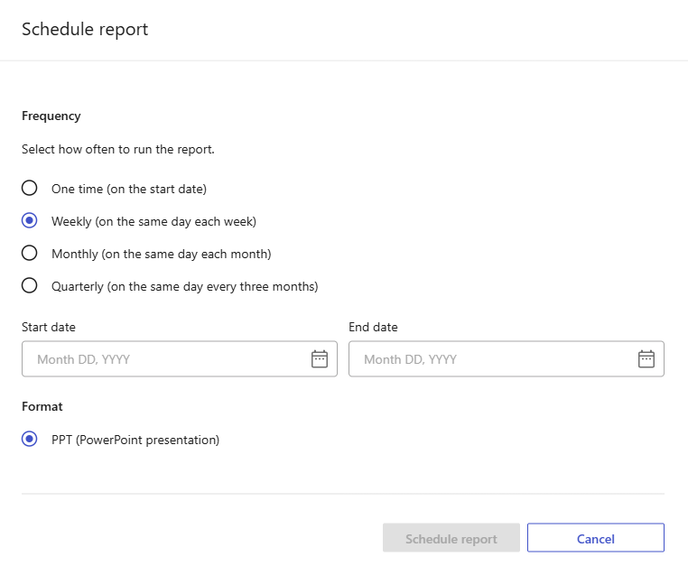

= Keystone 구독에 대한 상태 보고서를 생성하고 예약합니다.
:hardbreaks:
:allow-uri-read: 
:nofooter: 
:icons: font
:linkattrs: 
:imagesdir: ../media/

[role="lead"]
NetApp Console의 Keystone 대시보드에서 하나 이상의 Keystone 구독에 대한 상태 보고서를 생성하거나 예약할 수 있습니다. 이러한 보고서는 구독 사용량, 운영 상태, 위험 및 취약점에 대한 통합된 보기를 제공하며, 지정된 수신자와 공유할 수 있습니다. 이 기능은 Digital Advisor에서 사용할 수 없습니다.

.이 작업에 대해
상태 보고서를 통해 선택한 구독의 사용량, 운영 상태 및 식별된 위험 요소를 한눈에 파악할 수 있습니다. *새 보고서* 페이지에서 *보고서 구성* 패널을 사용하여 보고서의 범위와 옵션을 정의하십시오. 보고서를 생성하거나 예약하기 전에 미리 보기 영역을 사용하여 슬라이드 순서와 레이아웃을 검토하십시오. 미리 보기에는 보고서 구조만 표시되며 실제 구독 데이터는 표시되지 않습니다.

다음 단계를 따라 보고서를 생성하여 즉시 다운로드하거나, 일회성 또는 정기 보고서를 나중에 받을 수 있도록 예약하세요:

.단계
. 콘솔 왼쪽 탐색 메뉴에서 *스토리지 > Keystone > 모니터링 > 보고서*를 선택합니다.
. *새 보고서*를 선택합니다.
. *보고서 구성 패널*에서 *보고서 이름* 필드에 이름을 입력합니다.
. *시간 범위* 드롭다운 메뉴에서 시간 범위를 선택하세요.
+
*지난 60일* 등 사전 설정된 기간을 선택하거나 *사용자 지정*을 선택하여 직접 날짜를 입력하십시오. 선택한 기간은 *소비 추세* 섹션 및 기타 시간 기반 섹션에 표시되는 기간별 데이터를 결정합니다. *사용자 지정*을 선택하면 보고서를 예약할 수 없습니다.

+
image:../media/schedule-report.png["사용자 지정 날짜 범위를 선택할 때 예약이 비활성화됨을 보여주는 상태 보고서 구성"]

. *구독* 드롭다운 메뉴에서 하나 이상의 구독을 선택하세요.
+

NOTE: NetApp 파트너는 관리형 Keystone 고객 계정 중 하나 이상에서 구독을 선택할 수 있습니다.

. *보고서 섹션*에서 포함할 섹션을 선택합니다.
+
선택한 각 섹션은 미리보기 영역에 표시되며 생성된 보고서에 포함됩니다. 예를 들어, 구독 요약, 현재 용량 사용량, 소비 추세, 물리적 용량, 시스템 상태, 위험 및 취약점 등을 포함할 수 있습니다. *소비 추세*의 경우 과거 소비량 차트를 포함할 수 있으며, 선택적으로 미래 소비량 예측도 추가할 수 있습니다.

. 프레젠테이션 테마를 선택하세요.
. 미리보기 영역에 표시된 섹션을 검토하여 선택 사항과 일치하는지 확인하십시오.
. 보고서를 작성하는 방법을 선택하세요.
+
** *보고서 생성*
+
보고서를 즉시 다운로드하려면 *보고서 생성*을 선택하십시오.

+
보고서가 생성을 위해 제출되며, *보고서* 탭으로 돌아갑니다. 보고서가 *실행 중* 상태로 표시됩니다.

+
상태가 *생성됨*으로 변경되면 보고서 행 끝에 있는 점 세 개 아이콘을 선택한 다음 *다운로드*를 선택합니다.

** *보고서 예약*
+
일회성 또는 정기 보고서를 생성하려면 *예약*을 선택하고 다음 단계를 완료하십시오:

+
... 빈도를 선택하십시오: *1회*, *주간*, *월간* 또는 *분기별*.
... *시작 날짜*를 선택하십시오.
+

+
시작일은 보고서가 처음 실행되는 시점을 결정합니다. 반복 실행 빈도를 선택한 경우, 보고서는 선택한 주간, 월간 또는 분기별 일정에 따라 다시 실행됩니다.

... 선택적으로 *종료일*을 지정할 수 있습니다.
+
종료일을 선택하지 않으면, 변경할 때까지 일정이 계속 진행됩니다.

... *보고서 예약*을 선택합니다.
+
일정이 생성되면 *보고서* 탭에 실행 유형이 *예약 실행*인 보고서가 표시됩니다. *마지막 실행*, *다음 실행*, *상태* 열을 사용하여 각 실행을 추적하십시오.

+
주간, 월간 또는 분기별 일정을 편집하려면 보고서 행 끝에 있는 줄임표 아이콘을 선택한 다음 *일정 편집*을 선택하십시오. 상태가 *예약됨*이든 *생성됨*이든 이 작업을 수행할 수 있습니다. 보고서가 생성된 후에는 *일회성* 일정을 편집할 수 없습니다.

+
상태가 *생성됨*으로 변경되면 보고서 옆에 있는 점 세 개 아이콘을 선택하고 *다운로드*를 선택하십시오.

.결과
생성된 보고서는 PowerPoint 프레젠테이션으로 다운로드됩니다. 점 세 개 메뉴에서 *다시 생성*을 선택하여 동일한 구성으로 새 보고서를 생성할 수 있습니다.

* 관련 정보 *

* link:../integrations/dashboard-access.html["Keystone 대시보드 시작하기"]
* link:../integrations/subscriptions-tab.html["Keystone 구독에 대한 세부 정보 보기"]
* link:../integrations/current-usage-tab.html["현재 사용량 보기"]
* link:../integrations/consumption-tab.html["소비 경향 보기"]
* link:../integrations/assets-tab.html["구독과 관련된 자산을 확인하십시오"]
* link:../integrations/monitoring-alerts.html["알림 보기 및 관리"]
* link:../integrations/monitoring-alert-monitors.html["알림 모니터 보기 및 생성"]

